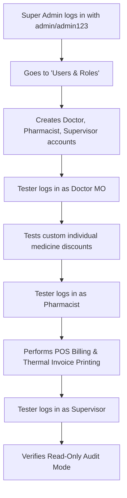

# 🏥 RVS Hospital Central Pharmacy & Dispensary Management System
## End-to-End Testing & Role Walkthrough Guide

**Live Web App:** [https://yatish.pythonanywhere.com](https://yatish.pythonanywhere.com)  
**System Version:** v1.0.0 (Production)  
**Primary Administrator:** `admin` / `admin123`

---

## 📌 1. System Architecture & Core Philosophy

The RVS Pharmacy system is designed specifically for **hospital central dispensaries and multi-counter clinical pharmacies**. 

Unlike public e-commerce stores:
1. **Zero Public Registration:** No outsider can create an account or self-assign a role. All staff accounts are created and supervised exclusively by the **Super Administrator**.
2. **Role-Based Access Control (RBAC):** Every action (pricing, discounts, billing, formulary editing, user management) is gated by strict clinical permissions.
3. **Smart Discount Policy (No Double-Discounting):** 
   - When an **Overall Bill Package Discount** is active, individual item discounts are **automatically paused** to protect hospital margins.
   - When the Overall Bill Discount is `0% (Standard / Unpause)`, individual medicine formulary discounts are **active**.

---

## 👥 2. The 4 Roles & Permission Matrix

| Feature / Action | Super Admin (`admin`) | Medical Officer (MO) | Pharmacist (Dispensary) | Supervisor (Auditor) |
|---|:---:|:---:|:---:|:---:|
| **Create & Manage User Logins** | ✅ Yes | ❌ Locked | ❌ Locked | ❌ Locked |
| **Overall Bill Package Discount** | ✅ Yes | ❌ Locked (Super Admin Only) | ❌ Locked | ❌ Locked |
| **Individual Medicine Discounts** | ✅ Yes | ✅ Yes (Full Authority) | ❌ Locked | ❌ Locked |
| **Edit Medicine Formulations & MRP** | ✅ Yes | ❌ Locked | ❌ Locked (Connect Admin) | ❌ Locked |
| **Inward New Stock & Batches** | ✅ Yes | ✅ Yes | ✅ Yes | ❌ Locked |
| **Patient POS Billing & Checkout** | ✅ Yes | ✅ Yes | ✅ Yes | ❌ Read-Only |
| **View Expiry Radar & Reports** | ✅ Yes | ✅ Yes | ✅ Yes | ✅ View Only |

---

## 🧪 3. Step-by-Step Testing Workflow for Your Tester

Share these exact steps with your friend to test every workflow from account creation to billing.

---

### Step 1: Start as Super Admin (Account Setup)
1. Visit [https://yatish.pythonanywhere.com](https://yatish.pythonanywhere.com).
2. Sign in with the master administrator credentials:
   - **Username:** `admin`
   - **Password:** `admin123`
3. Notice the **Dashboard Overview**:
   - Total formulations, active batches, today's sales, and the Expiry Alert Radar.
4. Open **Users & Roles** (click the button in the top header or in the sidebar):
   - In the **Create New Staff User** form, create 3 accounts for your test:
     * **Doctor (MO):** Username `doctor1`, Password `doc123`, Role: `Medical Officer / Doctor (MO)`.
     * **Pharmacist:** Username `pharma1`, Password `pharma123`, Role: `Pharmacist (Dispensary)`.
     * **Supervisor:** Username `super1`, Password `super123`, Role: `Supervisor (Read-Only / Auditor)`.
5. Open **Discount Control** in the sidebar under *Clinical Modules*:
   - In **Section 1 (Overall Bill Discount)**: Type any custom number like `10%` and reason `Senior Citizen OPD`. Click **Apply Overall Discount**.
   - Notice the live simulation: A ₹1,000 bill calculates ₹100 discount, patient pays ₹900.
   - Click preset **`0% (Standard / Unpause)`** and click Apply. Notice individual discounts unpause and become active.
6. Click **Logout** in the top right.

---

### Step 2: Test as Medical Officer / Doctor (MO)
1. Sign in with the doctor credentials created in Step 1:
   - **Username:** `doctor1`
   - **Password:** `doc123`
2. Open **Discount Control**:
   - **Section 1 (Overall Discount):** Verify the amber notice:  
     > *"Medical Officer Authority Notice: Overall bill package discount is restricted to Super Admin."*  
     Confirm the input and button are disabled (`Super Admin Only`).
   - **Section 2 (Individual Medicine Discounts):** Verify it is **fully active**:
     * Select any medicine from the dropdown.
     * Enter any custom percentage (e.g. `12.5%`) or click presets (`5%`, `10%`, `15%`, `20%`).
     * Look at the live price preview: Base MRP, Custom Discount, and Patient Price calculate instantly.
     * Click **Save Medicine Discount**.
     * In the table below, test clicking **Edit %** to change the number inline, or **Remove (0%)**.
3. Click **Logout**.

---

### Step 3: Test as Pharmacist (Counter Billing & Stock Inward)
1. Sign in with the pharmacist credentials:
   - **Username:** `pharma1`
   - **Password:** `pharma123`
2. Open **Billing Terminal**:
   - Add medicines to the cart.
   - Notice that pre-approved discounts set by Doctor or Admin **apply automatically**. The pharmacist cannot manually inflate or manipulate the discount.
   - Test the category chips (`Cardiac`, `Diabetics`, `Analgesics`, `IV Fluids`):
     * If a category has no items yet, verify it renders a clean clinical card with an icon and a `+ Add Medicine` button (never a blank white screen).
   - Enter patient name, mobile number, and select payment mode (`Cash`, `UPI / QR`, or `Card`).
   - Click **Complete Sale & Generate Bill**:
     * Verify stock is automatically deducted in real time.
     * A formatted thermal 80mm invoice appears with hospital seal, GST breakdown, and doctor/staff signatures.
3. Open **Medicine Inventory**:
   - Verify the pharmacist can click **+ New Medicine** to register new arriving stock.
   - Verify the pharmacist **cannot edit or alter base medicine pricing** (protected with "Connect with Admin to edit").
4. Click **Logout**.

---

### Step 4: Test as Supervisor (Read-Only Audit & Observer)
1. Sign in with the supervisor credentials:
   - **Username:** `super1`
   - **Password:** `super123`
2. Notice the yellow banner:
   > *"Supervisor Audit Mode: All records are read-only. Editing, deleting, and billing actions are locked."*
3. Test billing: The checkout button is locked.
4. Test inventory: Formularies and batches can be inspected, but adding and editing are disabled.
5. Inspect the **Expiry Date Radar** and **Recent Invoices** to verify audit visibility.

---

## 💡 4. Summary of Key Innovations Built for the User

1. **Custom Decimal Discounts:** No restriction to fixed buttons — doctors and admins can enter any custom number (`7%`, `12.5%`, `18%`, etc.) with live recalculation.
2. **Terminal Sync:** Discounts approved by MO or Super Admin push directly to all dispensary billing terminals.
3. **Real-Time Expiry Radar:** Flags items expiring within 30 days in amber and expired items in red.
4. **Clean Single-Admin Security:** Eliminates public registration and dummy test cards. Only authenticated personnel provisioned by Super Admin can enter the system.
